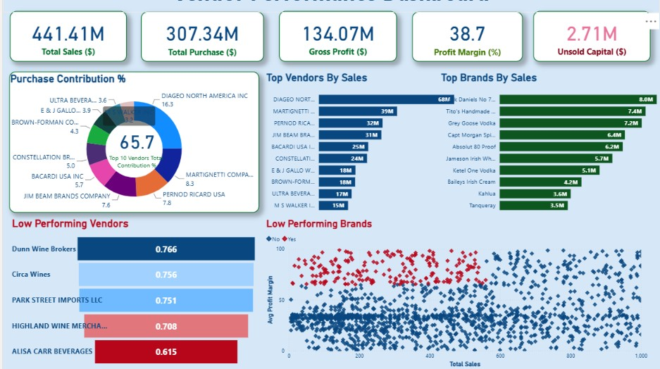

# Vendor Performance Analysis

**Python · SQL (SQLite) · Power BI**

An end-to-end analysis of vendor and brand performance for a wine and spirits distributor. I combined four raw tables (about 15.2 million records) into one vendor-brand summary table with SQL, analysed profitability, purchase concentration, inventory turnover and pricing in Python, tested a margin hypothesis statistically, and presented the results in a Power BI dashboard.



## Business Problem

A distributor buys from many vendors and sells thousands of brands. Management wants to know which vendors and brands drive profit, where purchasing is too concentrated, where capital is tied up in slow-moving stock, and which brands deserve promotion or a pricing review.

> **Question:** How can the company use its purchase, sales and invoice data to improve vendor selection, pricing and inventory decisions?

This is a portfolio project built on a public dataset.

## Key Findings

| Area | What the data shows |
|------|---------------------|
| **Scale** | Purchases, purchase prices, vendor invoices and sales (2,372,474 + 12,261 + 5,543 + 12,825,363 records) were reduced to a 10,692-row vendor-brand summary covering 126 vendors. |
| **Profitability** | After removing rows with no sales or no profit (8,565 of 10,692 rows kept, 119 vendors), purchases are $307.3M, sales $441.4M and gross profit $134.1M, an overall margin of 30.37%. |
| **Vendor concentration** | The top 10 vendors account for 65.69% of all purchase dollars, so supply depends heavily on a few vendors. |
| **Top sellers** | Diageo is the largest vendor by sales ($67.99M). Top vendors and top brands are shown in the dashboard. |
| **Promotion candidates** | 198 brands have low sales (below the 15th percentile) but high margins (above the 85th percentile), which makes them candidates for targeted promotion. |
| **Bulk purchasing** | Average unit purchase price falls from $39.06 (small orders) to $15.49 (medium) to $10.78 (large), about a 72% reduction in unit cost for large orders. |
| **Slow stock and unsold capital** | Vendors with stock turnover below 1 sold less than they bought. About $2.71M of capital is locked in unsold inventory. |
| **Margin test** | Top-25% sales vendors have a lower average margin (31.17%, 95% CI 30.74-31.61) than bottom-25% vendors (41.55%, 95% CI 40.48-42.62). Welch t-test: t = -17.64, p < 0.001, so the difference is statistically significant. |

## Business Value

The analysis helps a distributor decide:
- **How exposed it is to a few vendors:** two-thirds of purchase spend sits with ten vendors, so negotiation and supply-risk planning should start there.
- **Where to promote:** low-sales, high-margin brands are the first candidates for promotion or better shelf placement.
- **Where capital is stuck:** about $2.71M sits in unsold inventory, and low-turnover vendors need smaller orders or clearance.
- **Where to review pricing:** large-volume vendors earn lower margins than small ones, so their pricing and purchase terms deserve a closer look.

## What I Did

### 1. SQL: building the vendor summary table
- Loaded the raw CSV files into a SQLite database (`inventory.db`) with a Python ingestion script and logging.
- Explored the tables and checked one vendor end to end to understand how purchases, invoices and sales connect.
- Joined purchases, purchase prices, vendor invoices and sales with **CTEs** (`PurchaseSummary`, `SalesSummary`, `FreightSummary`) and `LEFT JOIN`s into one `vendor_sales_summary` table (10,692 rows).

### 2. Python: cleaning and feature engineering
- Converted `Volume` to a numeric type, filled 178 missing sales rows with 0 (brands that were purchased but never sold) and trimmed whitespace in vendor and product names.
- Created `GrossProfit`, `ProfitMargin`, `StockTurnover` and `SalesToPurchaseRatio`.
- Filtered to rows with positive gross profit, margin and sales quantity (8,565 rows) for the profitability analysis.

### 3. Python: exploratory analysis
- Summary statistics, histograms, boxplots and a correlation heatmap.
- Top vendors and brands by sales, vendor share of purchases (Pareto-style), unit price by order-size tier (`pd.qcut`), low-turnover vendors, and low-sales / high-margin brands.
- 95% confidence intervals and a Welch t-test (SciPy) comparing margins of top and bottom vendors.

### 4. Power BI: dashboard
- **KPI cards:** total purchase, total sales, gross profit, profit margin, unsold capital, top 10 vendor contribution.
- **Visuals:** purchase contribution donut, top vendors and top brands by sales, low-performing vendors, low-performing brands scatter.

### 5. Report
A written report summarises the problem, data preparation, findings, hypothesis test and recommendations.

## Recommendations

1. **Reduce dependence on the top 10 vendors.** Develop alternative suppliers and negotiate terms with the largest ones.
2. **Promote low-sales, high-margin brands.** Test targeted promotions or better placement on the 198 candidates.
3. **Cut or clear slow-moving stock.** Order smaller quantities for vendor-brand pairs with turnover below 1.
4. **Review pricing for high-volume vendors.** Their margins are lower than those of low-volume vendors.
5. **Use bulk purchasing where inventory can be managed.** Large orders have much lower unit prices, so negotiate volume pricing for fast-moving products.

## Skills Demonstrated
SQL (CTEs, joins, aggregation) · Python (pandas, matplotlib, seaborn, SciPy) · data cleaning and feature engineering · exploratory analysis · hypothesis testing and confidence intervals · Power BI dashboard design · turning data into business recommendations

## Assumptions and Limitations
- Rows with zero sales or non-positive gross profit were removed for the profitability analysis, so margin figures describe profitable rows only.
- "Vendors" in some charts are vendor-brand rows, so one vendor can appear more than once.
- `FreightCost` is a vendor-level total repeated on each of that vendor's rows, so it is not summed.
- No time dimension is used, so there are no trends over time.
- Findings describe patterns in this dataset and do not prove cause and effect.

## Repository Structure

```
├── README.md
├── ingestion_db.py                  # loads raw CSV files into SQLite
├── get_vendor_summary.py            # builds and cleans the vendor_sales_summary table
├── Exploratory Data Analysis.ipynb  # explores raw tables and builds the summary
├── Vendor Performance Analysis.ipynb# analysis, charts and hypothesis test
├── vendor_sales_summary.csv         # final summary table (10,692 rows)
├── vendor_performance.pbix          # Power BI dashboard
├── vendor_dashboard.jpg             # dashboard preview
└── Vendor Performance Report.pdf    # project report
```

The raw CSV files are too large for GitHub and are not included. Add them to a `data/` folder to rebuild the database.

## How to Run

1. Clone the repository
   ```bash
   git clone https://github.com/Pavana2003/vendor_performance_analysis.git
   cd vendor_performance_analysis
   ```
2. Install the Python libraries
   ```bash
   pip install pandas numpy matplotlib seaborn scipy sqlalchemy jupyter
   ```
3. Put the raw CSV files in a `data/` folder and create a `logs/` folder.
4. Run `python ingestion_db.py` to create `inventory.db`.
5. Run `python get_vendor_summary.py` to build the `vendor_sales_summary` table.
6. Open `Vendor_Performance_Analysis.ipynb` to reproduce the analysis, or use `vendor_sales_summary.csv` directly.
7. Open `vendor_performance.pbix` in Power BI Desktop.

## Dataset
Public wine and spirits distributor dataset with four tables: purchases, purchase prices, vendor invoices and sales (about 15.2 million records in total). The raw CSV files are not included because of their size.

## About Me
**Pavana K** | Aspiring Data Analyst | SQL · Python · Power BI · Excel
